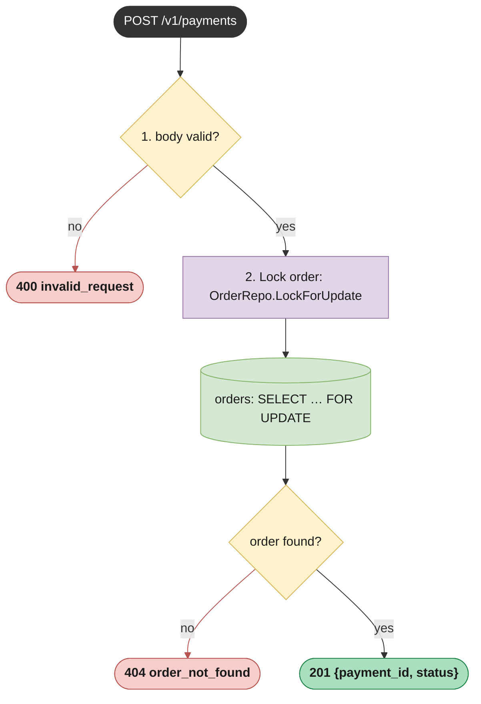

# Diagrams: colors and Mermaid (diagram version 8)

In draw.io mode the layout script applies all of this; agents read it only in Mermaid mode, where they write the colors themselves.

## 8. Colors, shapes, legend

Every diagram is colored by **component kind** and by **outcome**, and has a legend **[checked]**. You draw with the **light** palette below. All text is dark (`#1A1A1A`) except on the start node.

**Dark mode** is added afterwards by the orchestrator (`docs_tool.py svg-theme`). It removes draw.io's own automatic dark colors (the muddy browns), then adds the dark palette in the right-hand column, which the SVG switches to when the viewer is in dark mode. If the first Docmost sync shows that images don't follow Docmost's theme toggle, the theme is switched to **always light** for every diagram. The editable diagram inside the SVG always keeps the light palette.

| Kind | Shape | draw.io style |
|---|---|---|
| Start, step-number circles | pill / circle | `fillColor=#2F2F2F;strokeColor=#2F2F2F;fontColor=#FFFFFF;` |
| Client / user | rounded pill | `rounded=1;arcSize=50;whiteSpace=wrap;html=1;fillColor=#DAE8FC;strokeColor=#6C8EBF;fontColor=#1A1A1A;` |
| Step in this app | rounded box | `rounded=1;whiteSpace=wrap;html=1;fillColor=#E1D5E7;strokeColor=#9673A6;fontColor=#1A1A1A;` |
| Sub-flow reference | predefined process | `shape=process;whiteSpace=wrap;html=1;backgroundOutline=1;fillColor=#E1D5E7;strokeColor=#9673A6;fontColor=#1A1A1A;fontStyle=1;` |
| Decision | diamond | `rhombus;whiteSpace=wrap;html=1;fillColor=#FFF2CC;strokeColor=#D6B656;fontColor=#1A1A1A;` |
| Database (table, collection) — spec kind `db` | cylinder | `shape=cylinder3;boundedLbl=1;backgroundOutline=1;size=10;fillColor=#D5E8D4;strokeColor=#82B366;fontColor=#1A1A1A;` |
| File storage (local disk, NFS, SFTP) — `file` | folder | `shape=folder;tabWidth=46;tabHeight=12;tabPosition=left;fillColor=#F0E2C8;strokeColor=#A0844F;fontColor=#1A1A1A;` |
| Object storage (S3, GCS, MinIO bucket) — `object` | bucket (trapezoid) | `shape=trapezoid;flipV=1;size=0.1;fillColor=#F2D7E9;strokeColor=#A65C8C;fontColor=#1A1A1A;` |
| Cache / in-memory store (Redis, Memcached) — `cache` | hexagon | `shape=hexagon;size=0.08;fillColor=#E2EFDA;strokeColor=#548235;fontColor=#1A1A1A;` |
| Other storage (search index, etc.) — `store` | dashed cylinder | `shape=cylinder3;dashed=1;fillColor=#EEF3EE;strokeColor=#7A8C7A;fontColor=#1A1A1A;` |
| Queue / topic | parallelogram | `shape=parallelogram;perimeter=parallelogramPerimeter;whiteSpace=wrap;html=1;fixedSize=1;fillColor=#FFE6CC;strokeColor=#D79B00;fontColor=#1A1A1A;` |
| Other internal app | rounded box | `rounded=1;whiteSpace=wrap;html=1;fillColor=#B0E3E6;strokeColor=#0E8088;fontColor=#1A1A1A;` |
| External system | dashed box | `rounded=0;dashed=1;whiteSpace=wrap;html=1;fillColor=#F5F5F5;strokeColor=#666666;fontColor=#1A1A1A;` |
| Success terminal | pill, bold | `rounded=1;arcSize=50;whiteSpace=wrap;html=1;fillColor=#A9DFBF;strokeColor=#1E8449;fontColor=#1A1A1A;fontStyle=1;` |
| Error terminal | pill, bold | `rounded=1;arcSize=50;whiteSpace=wrap;html=1;fillColor=#F8CECC;strokeColor=#B85450;fontColor=#1A1A1A;fontStyle=1;` |
| Note (full condition) | note | `shape=note;size=12;whiteSpace=wrap;html=1;align=left;spacingLeft=6;fillColor=#FFF9DB;strokeColor=#D6B656;fontColor=#1A1A1A;` + connector `endArrow=none;dashed=1;strokeColor=#D6B656;` |

Dark palette applied by `svg-theme` (for reference; never draw with it):

| Kind | Light fill / stroke | Dark fill / stroke |
|---|---|---|
| Background | `#FFFFFF` | `#1E1E1E` |
| Text | `#1A1A1A` | `#E8E8E8` |
| Normal edges and arrowheads | `#333333` | `#B0B0B0` |
| Start, initial/final, step-number circles | `#2F2F2F` (white text) | `#5A5A5A` / `#8A8A8A` (light text) |
| Client / user | `#DAE8FC` / `#6C8EBF` | `#1F3A5F` / `#6C9BD2` |
| Step in this app, sub-flow, state | `#E1D5E7` / `#9673A6` | `#3B2A4F` / `#B39DDB` |
| Decision | `#FFF2CC` / `#D6B656` | `#4A3F12` / `#E0C35A` |
| Database | `#D5E8D4` / `#82B366` | `#1E4024` / `#7BC47F` |
| File storage | `#F0E2C8` / `#A0844F` | `#3D3220` / `#C9A86A` |
| Object storage | `#F2D7E9` / `#A65C8C` | `#4A2440` / `#D58BBF` |
| Cache | `#E2EFDA` / `#548235` | `#263A1C` / `#8FC26A` |
| Other storage | `#EEF3EE` / `#7A8C7A` | `#2B332B` / `#A3B5A3` |
| Queue / topic | `#FFE6CC` / `#D79B00` | `#4A3215` / `#F0A040` |
| Other internal app | `#B0E3E6` / `#0E8088` | `#0F3D40` / `#4FC3C9` |
| External system, frames | `#F5F5F5` / `#666666` | `#2B2B2B` / `#9E9E9E` |
| Success terminal, success edges | `#A9DFBF` / `#1E8449` | `#1B4D2E` / `#4CAF6E` |
| Error terminal, error edges | `#F8CECC` / `#B85450` | `#5C2323` / `#E57373` |
| Note | `#FFF9DB` / `#D6B656` | `#3D3820` / `#E0C35A` |

Use **only** the colors in these tables. Any other color won't get a dark version.

| Edge | draw.io style |
|---|---|
| Normal | `edgeStyle=none;rounded=1;arcSize=16;endArrow=block;endFill=1;html=1;strokeColor=#333333;fontColor=#1A1A1A;` (lines have **rounded corners**; every label has an explicit `fontColor` so dark mode can recolor it) |
| Main success path | add `strokeColor=#1E8449;strokeWidth=2;` |
| Error path | add `strokeColor=#B85450;` |
| Async | add `dashed=1;endArrow=open;` |

Sequence participants use the fill and stroke of their kind (`shape=umlLifeline;perimeter=lifelinePerimeter;…`). Frames (`shape=umlFrame`) are light grey `#F5F5F5`. Use `#E8F5E9` for a success branch frame and `#FDECEA` for an error branch frame.

**Legend**: `diagram_layout.py` adds it below the diagram, with one swatch per node kind and edge kind **used in that diagram** (and the step-number circle in sequence diagrams). Don't draw your own.

## 11. Mermaid version

Same rules, same colors. Each flowchart starts with the class definitions, and colors every node **[checked: `classDef` present]**:

- `linkStyle <indexes> stroke:#B85450` colors error edges (indexes count links in order, starting at 0). `-.->` marks async edges.
- Sequence diagrams: start with `autonumber` (numbered circles, same as draw.io mode); `participant` order as in section 5, `->>` sync, `-)` async, `-->>` reply. Wrap success/error alternatives in `rect rgb(232,245,233)` / `rect rgb(253,236,234)` inside `alt` blocks.
- Mermaid has no real legend. Add one line under the diagram: `Legend: purple = this app · green cylinder = datastore · orange = queue · grey dashed = external · red = error path`.
- Pitfalls: quote labels with spaces or symbols; don't use `end` as a node id; `DB[("label")]` for cylinders.

