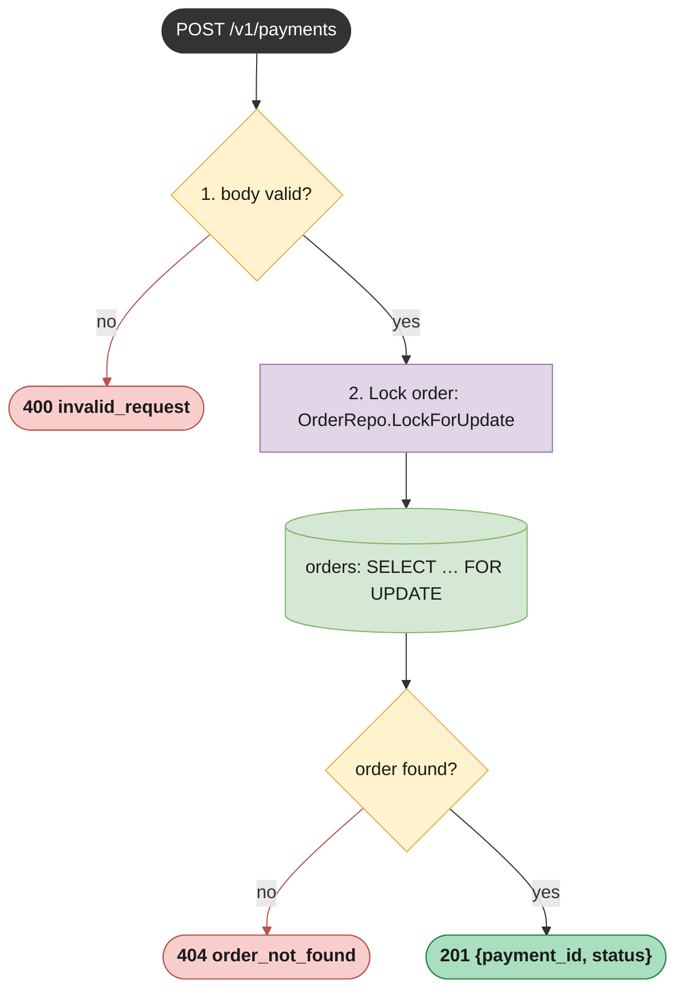

# Diagrams (template version 2)

Diagrams are the first thing readers look at, so they carry the detail. They are **colorful, complete and exact**: every branch the code can take, real names, real values. The validator checks the parts marked **[checked]**.

## Contents
1. Which diagrams, where
2. Mode: draw.io or Mermaid
3. Files and embedding
4. Flowcharts: every branch
5. Sequence diagrams
6. Structure, startup, data-flow
7. Detail inside the diagram
8. Colors, shapes, legend
9. Sub-flows instead of size limits
10. Mixed docs on update
11. Mermaid version

---

## 1. Which diagrams, where

| Diagram | Dev guide section | Operator guide section |
|---|---|---|
| Structure (components and how they connect) | `structure` | `how-it-works` |
| Startup flowchart | `startup` | `how-it-works` |
| Flowchart per important flow, with sub-flows | `app-flow/<flow-id>` | `app-flow/<flow-id>` |
| Sequence diagram per important flow | `app-flow/<flow-id>` | `app-flow/<flow-id>` |
| Data-flow diagram | `data-flow` | `data-flow` |

Every cell above is required **[checked]**. Both docs use the **same files**, with English labels, so they never disagree. Flows that are only listed in the index table get no diagram.

## 2. Mode

The orchestrator gives you the mode. Don't guess.

- **drawio**: read the draw.io skill's `SKILL.md` at the path you were given and use its workflow (generate, export, self-check by looking at the PNG, iterate). The output of every diagram is an **editable** `.drawio.svg`: export with the embed option (draw.io CLI `-x -f svg -e`) so the diagram XML stays inside the SVG **[checked]**. Keep `.drawio` sources and PNG previews in `docs/.docgen/.work/`.
- **mermaid**: fenced ` ```mermaid ` blocks in the markdown, identical in both docs. Section 11 shows how to apply the same colors and rules.

Before you call a diagram done, look at its rendered PNG (draw.io self-check): no overlapping labels, no edges crossing through nodes, every branch reaches a terminal or rejoins.

## 3. Files and embedding

```
docs/<app-id>/diagrams/
  structure.drawio.svg
  startup.drawio.svg
  data-flow.drawio.svg
  <flow-id>.flow.drawio.svg            # main flowchart          [checked: ".flow." in name]
  <flow-id>.flow.<sub-id>.drawio.svg   # sub-flow of that flow
  shared.<sub-id>.drawio.svg           # sub-flow reused by 2+ flows
  <flow-id>.seq.drawio.svg             # sequence diagram        [checked: ".seq." in name]
```

Embed each with a caption line, without em/en dashes because the operator guide uses the same lines (paths relative to the markdown file; split-mode files sit deeper, so adjust `../`):

```markdown
**Flowchart**


Sub-flow ▶ Validate request:


**Sequence**


```

## 4. Flowcharts: every branch

A flowchart shows **what decides what** inside the flow. Trace the code path and draw **every condition that changes the outcome**:

- validation failures, each distinct error or status code as its own exit
- auth/permission failures, not-found, conflict/duplicate/idempotency hits
- feature flags and config-driven switches (name the key)
- retries (count and backoff), timeouts (value and config key), circuit breakers, fallbacks
- caught exceptions and what happens next (rollback, compensate, log and continue)
- early returns, loops over items (show the loop with its exit condition)
- async hand-offs (publish and return, enqueue job), and what the caller gets at that point

Every path ends at a **success terminal** or an **error terminal**, or visibly rejoins another path. A decision diamond has every outgoing edge labelled with its condition (`valid`, `invalid → 400`, `order not found → 404`, `retry < 3`). Number the main-path steps so they match the numbered steps in the text (`1.`, `2.`…).

## 5. Sequence diagrams

A sequence diagram shows **who calls whom, in order**, for the same flow. One per important flow.

- Participants left to right in call order: caller, this app (split into its main layers when it helps: handler, service, repository), other internal apps, datastores, queues, external systems. Each participant head is colored by kind (section 8).
- Messages: **synchronous call** = solid line, filled arrowhead. **Async message** (publish, enqueue, fire-and-forget) = solid line, open arrowhead. **Reply** = dashed line, open arrowhead. Error replies are red.
- Label each message with its number and content: `3. INSERT payments (order_id, amount, status=PENDING)`, `5. POST /v2/charge {order_id, gross_amount}`, `6. 201 {transaction_id}`.
- Use `alt` / `opt` / `loop` frames for the branches from the flowchart that involve other participants (timeout, retry loop, not found), each frame labelled with its condition.

## 6. Structure, startup, data-flow

- **Structure**: the app's components (handlers, services, workers, schedulers, repositories, caches, clients) and how they connect, plus everything outside the app it talks to. Group the app's components inside one container labelled with the app name. Arrows labelled with protocol and purpose (`HTTP JSON`, `gRPC`, `SQL`, `publishes order.created`).
- **Startup**: flowchart from process start to "ready", in code order: config load and validation, logger, DI/wiring, connections (with retry/timeouts), migrations, workers/schedulers, server listen, readiness. Every fail-fast condition is an error terminal (`missing DB_DSN → exit 1`).
- **Data-flow**: external entities (who sends/receives data), processes (this app's flows), stores (tables, caches, buckets) and queues. Each arrow is labelled with the data that moves (`payment {id, status}`) and the direction. Include retention/cleanup jobs if they exist.

## 7. Detail inside the diagram

Put the facts a reader would otherwise have to dig out of code **in the diagram**:

| Element | Show |
|---|---|
| Entry | HTTP method + path, or topic/queue name, or cron schedule, or CLI command |
| Process step | step number, what it does, and the function/class (`2. Lock order: OrderRepo.LockForUpdate`) |
| Decision | the actual condition (`amount <= 0?`, `status == PAID?`) |
| Datastore | table and the operation with columns (`payments: INSERT id, order_id, amount, status=PENDING`) |
| Queue/topic | name and payload fields (`order.created {order_id, total, items[]}`) |
| External call | system, endpoint, timeout and its config key (`Midtrans POST /v2/charge · timeout 5s (PAYMENT_TIMEOUT_MS)`) |
| Retry | count, backoff, config key (`retry ×3, backoff 2s (CHARGE_RETRY)`) |
| Error terminal | status code / outcome and message (`502 gateway_timeout`, `payment stays PENDING`) |
| Success terminal | response code and body summary (`201 {payment_id, status}`) |

No file paths in diagrams (they're shared with the operator guide). Function and class names are fine.

## 8. Colors, shapes, legend

Every diagram is colored by **component kind** and by **outcome**, and has a legend **[checked]**. Set the page background to white (`background="#FFFFFF"` on the diagram) so it stays readable in GitLab and Docmost dark mode. All text is dark (`#1A1A1A`) except on the start node.

| Kind | Shape | draw.io style |
|---|---|---|
| Start | ellipse | `ellipse;whiteSpace=wrap;html=1;fillColor=#333333;strokeColor=#333333;fontColor=#FFFFFF;` |
| Client / user | rounded pill | `rounded=1;arcSize=50;whiteSpace=wrap;html=1;fillColor=#DAE8FC;strokeColor=#6C8EBF;fontColor=#1A1A1A;` |
| Step in this app | rounded box | `rounded=1;whiteSpace=wrap;html=1;fillColor=#E1D5E7;strokeColor=#9673A6;fontColor=#1A1A1A;` |
| Sub-flow reference | predefined process | `shape=process;whiteSpace=wrap;html=1;backgroundOutline=1;fillColor=#E1D5E7;strokeColor=#9673A6;fontColor=#1A1A1A;fontStyle=1;` |
| Decision | diamond | `rhombus;whiteSpace=wrap;html=1;fillColor=#FFF2CC;strokeColor=#D6B656;fontColor=#1A1A1A;` |
| Datastore / cache | cylinder | `shape=cylinder3;whiteSpace=wrap;html=1;boundedLbl=1;backgroundOutline=1;size=12;fillColor=#D5E8D4;strokeColor=#82B366;fontColor=#1A1A1A;` |
| Queue / topic | parallelogram | `shape=parallelogram;perimeter=parallelogramPerimeter;whiteSpace=wrap;html=1;fixedSize=1;fillColor=#FFE6CC;strokeColor=#D79B00;fontColor=#1A1A1A;` |
| Other internal app | rounded box | `rounded=1;whiteSpace=wrap;html=1;fillColor=#B0E3E6;strokeColor=#0E8088;fontColor=#1A1A1A;` |
| External system | dashed box | `rounded=0;dashed=1;whiteSpace=wrap;html=1;fillColor=#F5F5F5;strokeColor=#666666;fontColor=#1A1A1A;` |
| Success terminal | pill, bold | `rounded=1;arcSize=50;whiteSpace=wrap;html=1;fillColor=#A9DFBF;strokeColor=#1E8449;fontColor=#1A1A1A;fontStyle=1;` |
| Error terminal | pill, bold | `rounded=1;arcSize=50;whiteSpace=wrap;html=1;fillColor=#F8CECC;strokeColor=#B85450;fontColor=#1A1A1A;fontStyle=1;` |

| Edge | draw.io style |
|---|---|
| Normal | `endArrow=block;endFill=1;html=1;strokeColor=#333333;fontColor=#1A1A1A;` |
| Main success path | add `strokeColor=#1E8449;strokeWidth=2;` |
| Error path | add `strokeColor=#B85450;` |
| Async | add `dashed=1;endArrow=open;` |

Sequence participants use the fill and stroke of their kind (`shape=umlLifeline;perimeter=lifelinePerimeter;…`). Frames (`shape=umlFrame`) are light grey `#F5F5F5`. Use `#E8F5E9` for a success branch frame and `#FDECEA` for an error branch frame.

**Legend**: a bordered box titled "Legend" in the bottom-right corner, with one small swatch and label for each kind and edge style **used in that diagram**, and nothing else.

## 9. Sub-flows instead of size limits

There is no node limit. Completeness beats compactness. Readability comes from splitting, not from leaving branches out:

- A `.drawio.svg` shows only its **first page**, so never use multiple pages. Split into files instead.
- The main flowchart shows the whole flow end to end. Move a sub-process into its own sub-flow file when it has more than about 8 nodes of its own, or when 2 or more flows use it (then it's `shared.<sub-id>`).
- In the main flowchart, a sub-flow is one "sub-flow reference" node labelled `▶ <Sub-flow name>`, with the same name as its caption in the doc. Its outgoing edges still show every outcome the sub-flow can return (`valid`, `invalid → 400`).
- A sub-flow diagram starts with a Start node named after the parent step and ends with terminals that match those outcomes.

## 10. Mixed docs on update

- Mode mermaid, a stale section has `.drawio.svg` diagrams: keep them and add the "Diagram possibly outdated" mark (conventions §6). Don't replace them with Mermaid.
- Mode drawio, a stale section has Mermaid: redraw in draw.io.
- New sections use the current mode. A doc with both kinds is fine.

## 11. Mermaid version

Same rules, same colors. Each flowchart starts with the class definitions, and colors every node **[checked: `classDef` present]**:



- `linkStyle <indexes> stroke:#B85450` colors error edges (indexes count links in order, starting at 0). `-.->` marks async edges.
- Sequence diagrams: `participant` order as in section 5, `->>` sync, `-)` async, `-->>` reply. Wrap success/error alternatives in `rect rgb(232,245,233)` / `rect rgb(253,236,234)` inside `alt` blocks.
- Mermaid has no real legend. Add one line under the diagram: `Legend: purple = this app · green cylinder = datastore · orange = queue · grey dashed = external · red = error path`.
- Pitfalls: quote labels with spaces or symbols; don't use `end` as a node id; `DB[("label")]` for cylinders.
