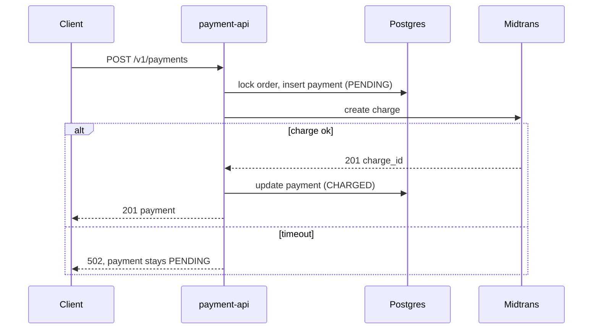

# Diagrams

Every important flow and the data-flow section gets a diagram. The same diagram is used in the dev doc and the operator guide, so labels are **English**, short, and use real names (endpoint, table, topic, external system). No file paths in labels.

## Which mode

The orchestrator tells you the mode. Don't guess.

- **drawio**: the user invoked the draw.io skill. Read its SKILL.md at the path you were given and follow its workflow. Final output for each diagram is `docs/<app-id>/diagrams/<diagram-id>.drawio.svg`, an SVG with the diagram embedded so it stays editable in draw.io and renders in GitLab. Export with the embed option (draw.io CLI: `-x -f svg -e`). Keep intermediates in `docs/.docgen/.work/`, not next to the docs.
- **mermaid**: write a fenced ` ```mermaid ` block directly in the markdown. Put the identical block in both docs.

Embedding a `.drawio.svg` (path relative to the markdown file; split-mode files sit one or two folders deeper, so adjust `../`):

```markdown

```

`<diagram-id>` = the flow ID (`create-payment`) or `data-flow`, `startup`, `structure`.

## Mixed docs on update

- The section's code changed, the mode is mermaid, and the section has a `.drawio.svg`: **keep** the drawio image and add the "Diagram possibly outdated" mark (conventions §6). Don't replace it with Mermaid.
- The section's code changed, the mode is drawio, and the section has a Mermaid block: redraw it in draw.io.
- New sections use the current mode. A doc with both kinds is fine.

## Choosing the type

| Situation | Diagram |
|---|---|
| Flow passes between 2+ participants (client, this app, DB, queue, external API, other service) | Sequence diagram |
| Flow is mostly decisions/branches inside the app | Flowchart, top-down |
| `data-flow` section | Data-flow diagram: external entities (rectangle), processes (rounded), stores (cylinder), arrows labelled with the data that moves, left-to-right |
| Startup with more than 6 steps (optional) | Flowchart |
| Frontend page flow | Flowchart of user actions → API calls → screens |

## Size

- At most about 15 nodes or participants, and about 25 messages in a sequence diagram. Above that, draw an overview plus one diagram per sub-step, each with its own caption.
- Show errors that change behavior (alt/else blocks, a "fail" branch), not every validation.
- Name things as the code does, so readers can grep: `payments` table, `order.created` topic, `Midtrans` API.

## Mermaid pitfalls

- Quote labels with spaces or symbols: `A["POST /v1/payments"]`.
- Don't use `end` as a node id, and don't put unquoted parentheses or slashes in flowchart labels.
- Sequence participants: `participant API as payment-api`.
- Data-flow store shape: `DB[("payments (Postgres)")]`.

Example (sequence):


